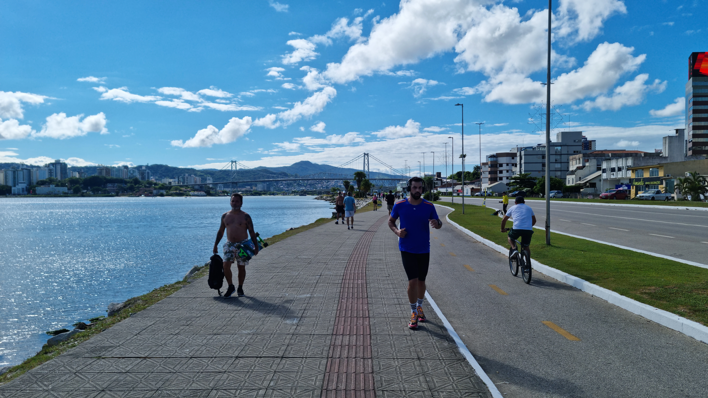

---

layout: post
title: "Florianópolis em 5 dias: roteiro completo para conhecer a Ilha"
description: "Vai passar 5 dias em Florianópolis? Confira um roteiro por regiões com praias, natureza, cultura açoriana, Ilha do Campeche e dicas para aproveitar melhor a viagem."
date: 2026-11-22
last_modified_at: 2026-11-22
categories:

- Florianópolis

Florianópolis em 5 dias: roteiro completo para conhecer a Ilha

Atualizado em novembro de 2026

Cinco dias em Florianópolis permitem conhecer muito mais do que algumas praias famosas. É tempo suficiente para explorar diferentes paisagens da Ilha, descobrir comunidades tradicionais, experimentar a gastronomia local e reservar um dia para conhecer a impressionante Ilha do Campeche.

Mas existe um detalhe importante: Florianópolis é extensa, e o deslocamento entre as regiões pode consumir boa parte do dia, principalmente durante a temporada de verão. Por isso, a melhor estratégia é organizar o roteiro por áreas próximas, evitando atravessar a cidade repetidas vezes.

Neste guia, você encontra uma sugestão de viagem de cinco dias que combina praias, natureza, patrimônio histórico e experiências locais, com espaço para aproveitar cada lugar sem transformar as férias em uma corrida contra o relógio.

Resumo do roteiro de 5 dias em Florianópolis

Dia| Região| Principais atrações
1| Centro| Centro Histórico, Mercado Público, Praça XV e Ponte Hercílio Luz
2| Leste da Ilha| Lagoa da Conceição, Joaquina e Barra da Lagoa
3| Sul da Ilha| Praia do Campeche e Ilha do Campeche
4| Sul da Ilha| Armação, Matadeiro e Ribeirão da Ilha
5| Norte da Ilha| Jurerê, Canasvieiras e Santo Antônio de Lisboa como alternativa

O roteiro pode ser adaptado conforme o clima, a localização da hospedagem e o meio de transporte disponível. A ordem dos dias também pode mudar, especialmente para aproveitar uma janela de boas condições de navegação até a Ilha do Campeche.

Dia 1 — Centro Histórico: conheça a Florianópolis que conta histórias

<figure>
  
  <figcaption>Comece a viagem conhecendo a história e a vida cotidiana da capital catarinense.</figcaption>
</figure>Antes de explorar as praias, vale conhecer um pouco da história de Florianópolis. O Centro reúne construções históricas, espaços culturais, comércio tradicional e lugares que ajudam a compreender a formação da cidade.

Comece pela Praça XV de Novembro, um dos espaços públicos mais conhecidos da capital. No entorno estão a Catedral Metropolitana e construções que fazem parte da memória urbana da cidade.

Caminhe pelas ruas do Centro Histórico e siga até o Mercado Público de Florianópolis. É uma boa oportunidade para conhecer a gastronomia local, observar o movimento dos comerciantes e experimentar sabores ligados à cultura da Ilha.

O que conhecer no primeiro dia

- Praça XV de Novembro: espaço histórico no coração da cidade.
- Catedral Metropolitana: referência arquitetônica e religiosa do Centro.
- Mercado Público: gastronomia, comércio e convivência.
- Largo da Alfândega: área de circulação e patrimônio histórico.
- Ponte Hercílio Luz: um dos principais símbolos de Florianópolis.

No fim da tarde, siga em direção à região da Beira-Mar Norte ou à cabeceira insular da Ponte Hercílio Luz para apreciar a paisagem da baía.

Sugestão: faça esse primeiro dia em um ritmo tranquilo. É uma boa maneira de começar a viagem, especialmente se você chegou à cidade depois de um deslocamento longo.

Dia 2 — Lagoa da Conceição, Joaquina e Barra da Lagoa

<figure>
  
  <figcaption>O lado leste da Ilha combina lagoa, dunas, praias e comunidades ligadas à pesca.</figcaption>
</figure>O segundo dia é dedicado ao lado leste de Florianópolis, uma região que reúne paisagens diferentes em distâncias relativamente curtas.

Comece pela Lagoa da Conceição, um dos lugares mais conhecidos da Ilha. Caminhe pelo centrinho, observe o movimento no entorno da lagoa e aproveite para tomar café ou experimentar algum restaurante da região.

A Lagoa também é um ponto de encontro para atividades ao ar livre, como stand up paddle, caiaque e passeios náuticos. A disponibilidade depende das condições climáticas e dos operadores locais.

Joaquina: dunas e mar aberto

Depois, siga para a Praia da Joaquina, conhecida pelas ondas e pelo campo de dunas.

As dunas são uma das paisagens mais características dessa parte da Ilha. Além de caminhar e observar o cenário, é possível encontrar atividades recreativas oferecidas por operadores locais.

Respeite a vegetação e evite circular fora das áreas permitidas.

Barra da Lagoa: tradição e vida comunitária

Na sequência, conheça a Barra da Lagoa, uma comunidade que preserva fortes vínculos com a pesca artesanal e a cultura marítima.

Caminhe pela região do canal, observe os barcos e atravesse a ponte pênsil para conhecer os caminhos que levam às piscinas naturais, conforme as condições de acesso e do mar.

A Barra é um lugar interessante para observar uma Florianópolis que vai além das praias mais conhecidas: uma comunidade onde a relação com o mar faz parte da rotina.

Sugestão: escolha um restaurante local para almoçar ou encerrar o dia. Aproveitar a gastronomia da região também é uma maneira de conhecer a identidade do território.

Dia 3 — Praia do Campeche e Ilha do Campeche

<figure>
  
  <figcaption>Reserve um dia para conhecer um dos cenários naturais mais especiais de Florianópolis.</figcaption>
</figure>Este é um dos dias mais aguardados do roteiro.

A Praia do Campeche possui uma extensa faixa de areia, mar aberto e uma vista privilegiada para a Ilha do Campeche. É uma região que combina paisagem natural, bairros residenciais e uma atmosfera própria do sul da Ilha.

Se as condições de navegação permitirem e houver disponibilidade de autorização, reserve parte do dia para visitar a Ilha do Campeche.

Ilha do Campeche: natureza e patrimônio arqueológico

A Ilha do Campeche é conhecida pelas águas claras e pela paisagem preservada, mas sua importância vai muito além da beleza natural.

O território guarda um patrimônio arqueológico relevante, com inscrições rupestres e vestígios da ocupação humana antiga. Por isso, a visitação é controlada e precisa seguir as orientações dos órgãos responsáveis e dos monitores credenciados.

Antes de organizar a travessia, considere alguns cuidados:

- Consulte o sistema oficial de autorização e disponibilidade de visitação.
- Utilize embarcações autorizadas e confirme o ponto de embarque.
- Verifique a previsão do tempo e as condições de navegação.
- Respeite os horários e as orientações dos responsáveis pela visita.
- Não alimente os quatis nem retire plantas, pedras ou qualquer elemento natural ou arqueológico.
- Leve de volta todo o lixo produzido durante a visita.

O desembarque depende das condições do mar e pode ser suspenso por motivos de segurança ou preservação. Portanto, não considere a travessia garantida apenas por ter reservado uma data.

Consulte as informações atualizadas diretamente no "sistema oficial de visitação da Ilha do Campeche" (https://ilhadocampeche.pmf.sc.gov.br/).

E se não for possível visitar a Ilha?

Não deixe que uma alteração no clima comprometa o dia. Aproveite a Praia do Campeche, conheça o bairro e explore outros trechos do litoral sul.

O importante é manter flexibilidade: em Florianópolis, as condições do mar podem mudar os planos de quem organiza atividades náuticas.

Dia 4 — Sul da Ilha: Armação, Matadeiro e Ribeirão da Ilha

<figure>
  
  <figcaption>O sul da Ilha revela paisagens, comunidades tradicionais e uma relação histórica com o mar.</figcaption>
</figure>O quarto dia é dedicado a uma das regiões mais interessantes para quem deseja conhecer a identidade cultural de Florianópolis.

Comece pela Praia da Armação, uma antiga comunidade pesqueira que mantém uma relação histórica com o mar. Observe os barcos, caminhe pela orla e conheça o cotidiano de uma região que preserva parte da memória marítima da cidade.

Praia do Matadeiro: natureza e caminhada

A partir da Armação, é possível chegar à Praia do Matadeiro por um caminho a pé, atravessando a região próxima ao rio.

O Matadeiro tem acesso mais restrito a veículos e uma paisagem cercada por morros e vegetação. É uma boa escolha para quem gosta de caminhar e prefere praias com uma atmosfera menos urbana.

Observe as condições do mar antes de entrar na água e respeite os acessos e as áreas de preservação.

Ribeirão da Ilha: arquitetura e gastronomia açoriana

Reserve a segunda parte do dia para conhecer o Ribeirão da Ilha, uma das comunidades mais representativas da herança açoriana em Florianópolis.

As construções tradicionais, a paisagem da baía e a presença de atividades ligadas à maricultura formam um conjunto cultural muito particular.

A região é conhecida pela produção de ostras e pela gastronomia baseada em frutos do mar. É uma excelente oportunidade para experimentar pratos locais e conhecer um pouco mais sobre a relação entre a comunidade e as águas da baía.

Se possível, escolha um estabelecimento que valorize produtores e ingredientes da região.

Sugestão: não transforme o Ribeirão em apenas uma parada para fotografias. Caminhe pelas ruas, observe a arquitetura e reserve tempo para apreciar a paisagem. É um lugar que merece ser conhecido sem pressa.

Dia 5 — Norte da Ilha: praias e diferentes estilos de Florianópolis

<figure>
  
  <figcaption>O norte da Ilha reúne praias com diferentes características e estruturas para visitantes.</figcaption>
</figure>Para encerrar a viagem, explore o norte de Florianópolis. Essa região reúne praias com perfis diferentes, desde áreas com maior estrutura turística até trechos mais tranquilos, dependendo da época do ano.

A escolha das praias deve considerar o tempo disponível, as condições do mar e o estilo de viagem.

Jurerê: estrutura e movimento

Jurerê é conhecida pela infraestrutura, pelos restaurantes e pela oferta de serviços turísticos.

É uma alternativa para quem deseja passar algumas horas na praia com facilidade de acesso a estabelecimentos comerciais e opções de alimentação.

Canasvieiras: praia urbana e comércio

Canasvieiras é uma das praias tradicionais do turismo de verão em Florianópolis. Possui comércio, restaurantes, hospedagens e uma estrutura voltada para receber visitantes.

É uma opção prática para famílias e viajantes que gostam de ter serviços próximos à praia.

Santinho: natureza e paisagem

Se a preferência for por uma paisagem mais natural, considere a Praia do Santinho.

A região combina mar aberto, dunas e costões. Também possui registros arqueológicos em seu entorno, que ajudam a contar a história da ocupação humana na Ilha.

Respeite as áreas protegidas e não toque ou retire elementos dos sítios arqueológicos.

Uma alternativa: Santo Antônio de Lisboa

Se você prefere cultura, gastronomia e patrimônio histórico a passar o dia em praias, pode substituir parte do roteiro do norte por uma visita a Santo Antônio de Lisboa.

A comunidade é conhecida pelas construções de influência açoriana, pela paisagem da baía e pelos restaurantes especializados em frutos do mar.

É um ótimo lugar para observar o pôr do sol e encerrar a viagem com uma experiência gastronômica.

Atenção ao deslocamento: Santo Antônio de Lisboa fica em outra parte da Ilha em relação às praias do norte. Para incluí-lo no mesmo dia, organize os horários e considere o trânsito. Se preferir um roteiro mais tranquilo, escolha entre as duas propostas.

Quanto custa uma viagem de 5 dias em Florianópolis?

O custo de uma viagem para Florianópolis varia bastante conforme a época do ano, o tipo de hospedagem, a alimentação, o transporte e as atividades escolhidas.

Não existe um valor único que represente todos os viajantes. Uma viagem econômica, com hospedagem compartilhada e alimentação planejada, terá um orçamento diferente de uma experiência com hotel, restaurantes e passeios privativos.

Para organizar seu planejamento, considere estas categorias:

Despesa| O que considerar
Hospedagem| Hotel, pousada, hostel ou aluguel por temporada
Alimentação| Cafés, restaurantes, mercados e refeições locais
Transporte| Carro, aplicativo, transporte público ou transfer
Experiências| Travessia para a Ilha do Campeche e atividades náuticas
Extras| Estacionamento, ingressos e imprevistos

A Ilha do Campeche merece atenção especial no orçamento, pois a visitação envolve autorização e transporte, conforme a modalidade escolhida. Consulte os valores e a disponibilidade antes de fechar o planejamento.

Uma boa estratégia é definir primeiro o orçamento de hospedagem e transporte. Depois, escolha quais experiências são prioritárias.

Onde ficar para aproveitar melhor o roteiro?

A localização da hospedagem influencia diretamente o tempo de deslocamento.

Para uma viagem de cinco dias, vale escolher uma região que facilite o acesso às atividades que você pretende realizar.

- Centro: interessante para quem prioriza patrimônio histórico, comércio e deslocamentos para diferentes regiões.
- Lagoa da Conceição: boa base para explorar o leste da Ilha e ter acesso a restaurantes e atividades ao ar livre.
- Campeche: alternativa estratégica para quem deseja explorar o sul e organizar a visita à Ilha do Campeche.
- Norte da Ilha: indicado para quem prefere concentrar a hospedagem perto de praias como Jurerê, Canasvieiras e Ingleses.

Não existe uma região perfeita para todos. A melhor escolha depende do perfil da viagem, do orçamento e da necessidade de deslocamento.

Leia também: [Onde ficar em Florianópolis: conheça as melhores regiões para se hospedar]({{ '/blog/onde-ficar-florianopolis/' | relative_url }}).

É possível conhecer Florianópolis em 5 dias sem carro?

Sim, mas é importante planejar os deslocamentos com mais atenção.

Florianópolis possui transporte coletivo, aplicativos de mobilidade e serviços privados de transporte. Entretanto, algumas praias e atrações podem exigir mais tempo de deslocamento ou conexões entre linhas.

Quem viaja sem carro pode escolher uma hospedagem próxima às atividades prioritárias e concentrar os passeios por região.

Para trajetos mais específicos, transfers e serviços de receptivo podem facilitar o acesso a praias, embarques e experiências.

Confira também: [Florianópolis sem carro: como explorar a Ilha usando transporte e outras alternativas]({{ '/blog/florianopolis-sem-carro/' | relative_url }}).

Qual é a melhor época para fazer esse roteiro?

Florianópolis pode ser visitada durante todo o ano, mas cada estação oferece características diferentes.

- Verão: dias mais longos, temperaturas elevadas, praias movimentadas e maior procura por atividades náuticas.
- Outono: temperaturas geralmente mais amenas e possibilidade de aproveitar a cidade com menor movimento fora dos feriados.
- Inverno: clima mais frio, paisagens diferentes e oportunidades para conhecer a gastronomia e a cultura local.
- Primavera: temperaturas em elevação e boas possibilidades para atividades ao ar livre, dependendo das condições do tempo.

Para visitar a Ilha do Campeche, o fator decisivo não é apenas a estação: as condições de navegação e as regras de visitação precisam ser verificadas antes da viagem.

Veja o guia completo: [Melhor época para visitar Florianópolis: o que esperar mês a mês]({{ '/blog/melhor-epoca-florianopolis/' | relative_url }}).

Dicas para aproveitar melhor os cinco dias

Antes de viajar, vale considerar alguns detalhes que fazem diferença na experiência:

1. Organize o roteiro por região: evite atravessar a Ilha várias vezes no mesmo dia.
2. Consulte a previsão do tempo: especialmente antes de atividades no mar e da visita à Ilha do Campeche.
3. Reserve com antecedência: hospedagens e experiências disputadas podem ter disponibilidade limitada na alta temporada.
4. Tenha flexibilidade: troque a ordem dos dias se as condições climáticas exigirem.
5. Valorize os negócios locais: restaurantes, produtores, artesãos e serviços comunitários fazem parte da identidade de Florianópolis.
6. Respeite os ambientes naturais: leve seu lixo de volta, preserve a vegetação e siga as orientações das áreas protegidas.
7. Não tente conhecer tudo: escolha experiências que façam sentido para o seu ritmo de viagem.

Vale a pena ficar 5 dias em Florianópolis?

Sim. Cinco dias oferecem um bom equilíbrio entre conhecer os principais cenários da Ilha e ter tempo para experiências que vão além das praias mais famosas.

Você pode caminhar pelo Centro Histórico, conhecer a Lagoa da Conceição, explorar comunidades pesqueiras, visitar a Ilha do Campeche e experimentar a gastronomia açoriana.

O segredo está em compreender que Florianópolis não é apenas um conjunto de praias. É um território de histórias, comunidades, paisagens e modos de vida que merecem ser descobertos com atenção.

Se você tem cinco dias disponíveis, aproveite para conhecer a Ilha sem pressa e deixar espaço para aquilo que não estava no planejamento.

Viaje com propósito. Descubra Florianópolis além do óbvio.

---

Continue planejando sua viagem

- [O que fazer em Florianópolis em 3 dias: roteiro prático por região]({{ '/blog/roteiro-florianopolis-3-dias/' | relative_url }})
- [O que fazer em Florianópolis em 7 dias: roteiro para explorar a Ilha com calma]({{ '/blog/roteiro-florianopolis-7-dias/' | relative_url }})
- [Onde ficar em Florianópolis: conheça as melhores regiões para se hospedar]({{ '/blog/onde-ficar-florianopolis/' | relative_url }})
- [Florianópolis sem carro: como explorar a Ilha]({{ '/blog/florianopolis-sem-carro/' | relative_url }})
- [Melhor época para visitar Florianópolis: guia mês a mês]({{ '/blog/melhor-epoca-florianopolis/' | relative_url }})

SustainaTrip Turismo — Viaje com Propósito.